# Proposed design diagrams

These diagrams describe the planned game, not implemented code. Four compact class views together form the Design Class Diagram. Types and system names match the [architecture contracts](03-architecture.md). Editable Mermaid sources accompany each rendered image. Multiplicities show intended instance counts; dotted arrows denote dependencies.

## Architecture comparison

### 01 — Single-thread custom 2.5D

All gameplay, generation, meshing, and rendering share the main thread. This is the smallest prototype but exposes movement to generation stalls. [Mermaid source](diagrams/01-architecture-single-thread.mmd)

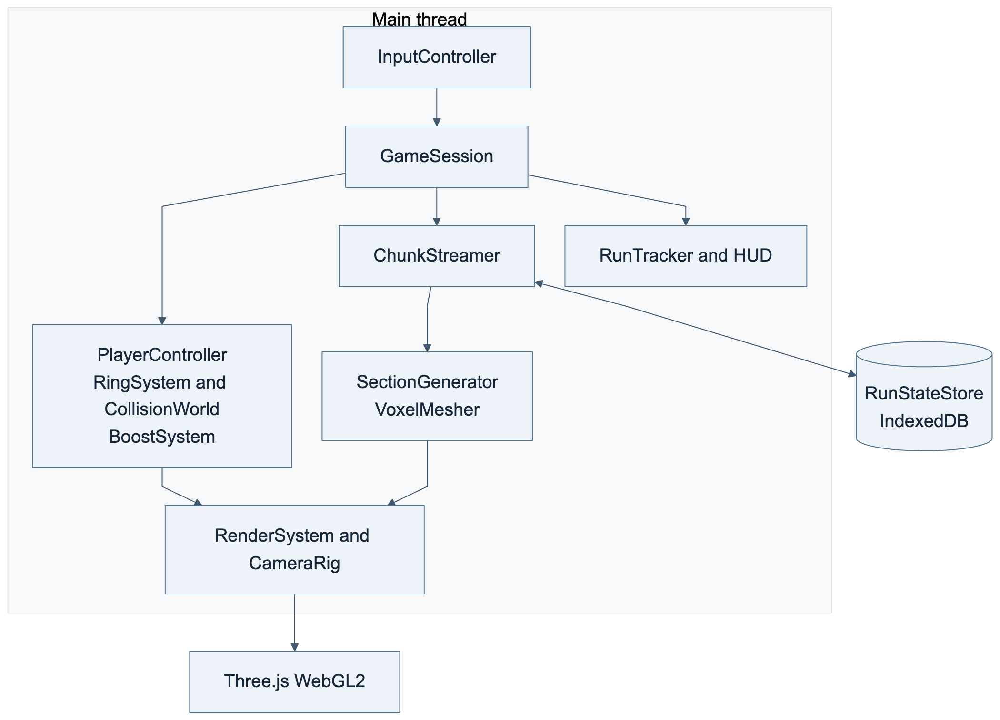

### 02 — Modular 2.5D with generation worker

Recommended architecture: gameplay remains on the main thread while a module worker builds sections and transferable mesh buffers. [Mermaid source](diagrams/02-architecture-worker.mmd)

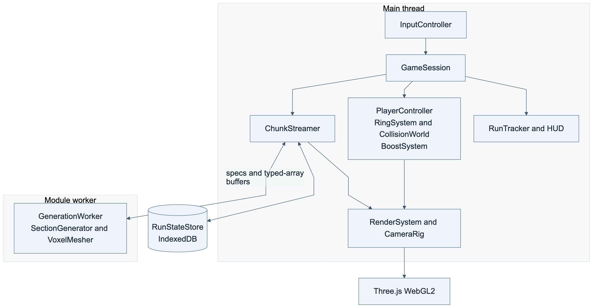

### 03 — Constrained Rapier 3D alternative

A 3D physics world adds circular constraints and rotating-body synchronization. Reserve this alternative for a design that needs radial movement. [Mermaid source](diagrams/03-architecture-rapier.mmd)

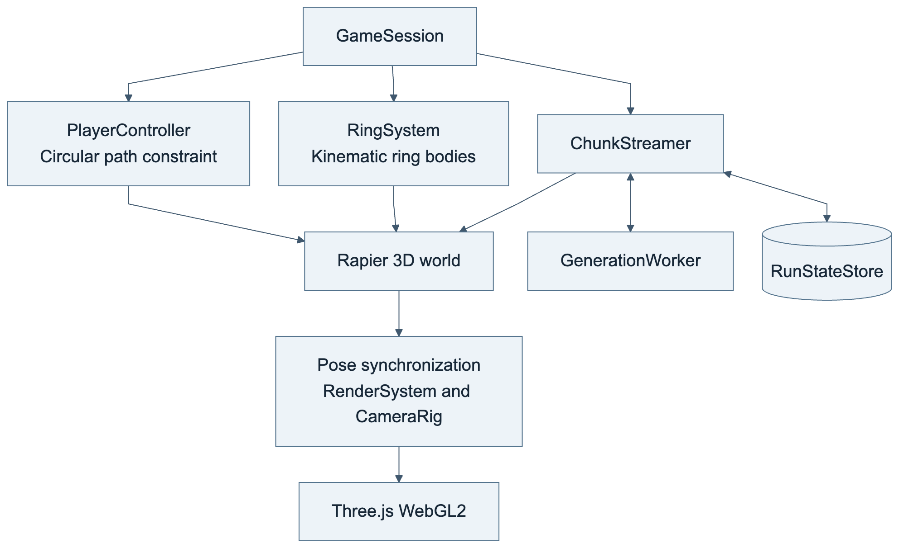

## Design Class Diagram

### 04 — Movement and boosts

Player state, relative collision, ring contact, and inventory form the movement view. Support is optional; boosts remain separate from movement mode. Compact labels use `Height` for `LogicalHeight` and `Mode` for `MovementMode`. [Mermaid source](diagrams/04-dcd-runtime.mmd)

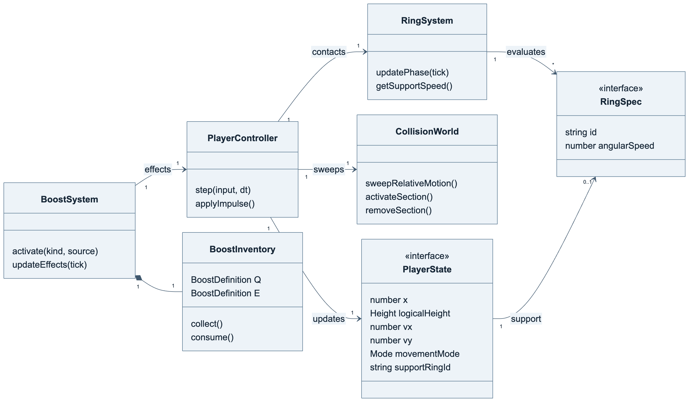

### 12 — Session and presentation

The session owns input, timing, presentation, and metrics. Rendering follows authoritative state without making movement decisions. [Mermaid source](diagrams/12-dcd-session-presentation.mmd)

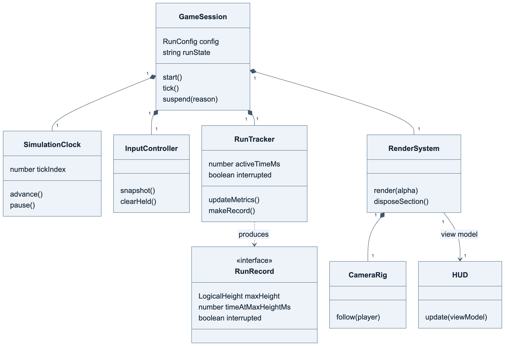

### 05 — Worker pipeline and persistence

The streamer combines worker output and the journal before activation. Requests/results contain plain data and transferable buffers. Compact labels use `num` for `number`, `Key` for `SectionKey`, and `Mesh` for `RingMeshBuffers`. [Mermaid source](diagrams/05-dcd-world-pipeline.mmd)

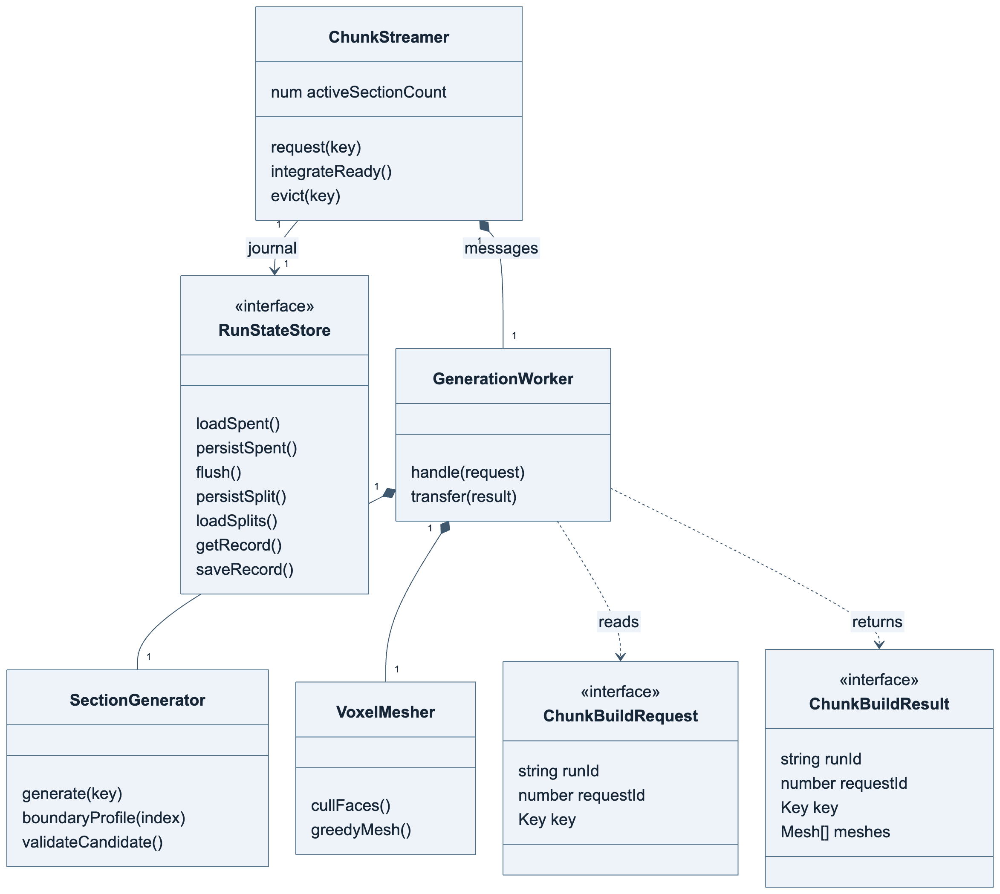

### 13 — World data model

Platforms and entities reference rings and shared effects. Canonical boundaries coordinate neighbours; mesh buffers retain ring ownership. Compact labels use `num` for `number`, `Sockets` for `RouteSocket[]`, `Ranges` for the platform's angle-interval array, and `headroom` for `reservedHeadroom`. Full types are in the architecture contracts. [Mermaid source](diagrams/13-dcd-world-data.mmd)

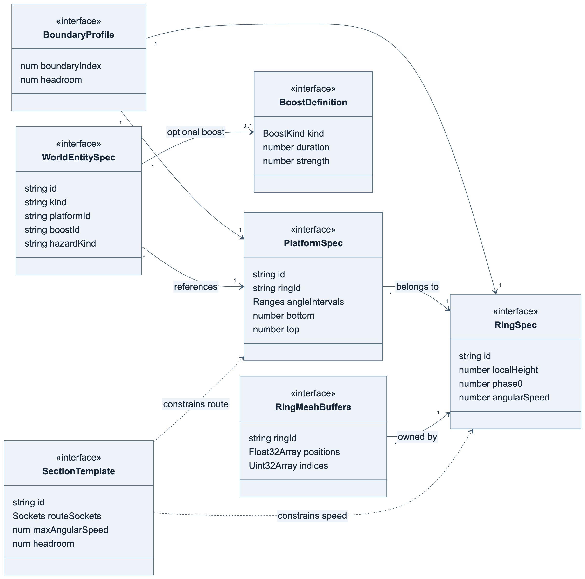

## Runtime sequences

### 06 — Movement and rotating contact

Ring phase precedes the movement sweep. Contact carries grounded players, while takeoff inherits ring speed once. [Mermaid source](diagrams/06-sequence-movement.mmd)

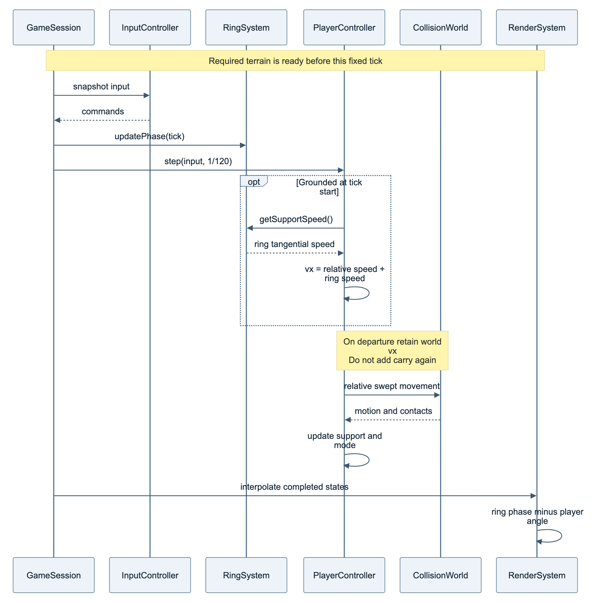

### 07 — Items and environmental boosts

Inventory items and pads share effect definitions. Successful activation consumes items; pads rearm after exit and cooldown. [Mermaid source](diagrams/07-sequence-boost.mmd)

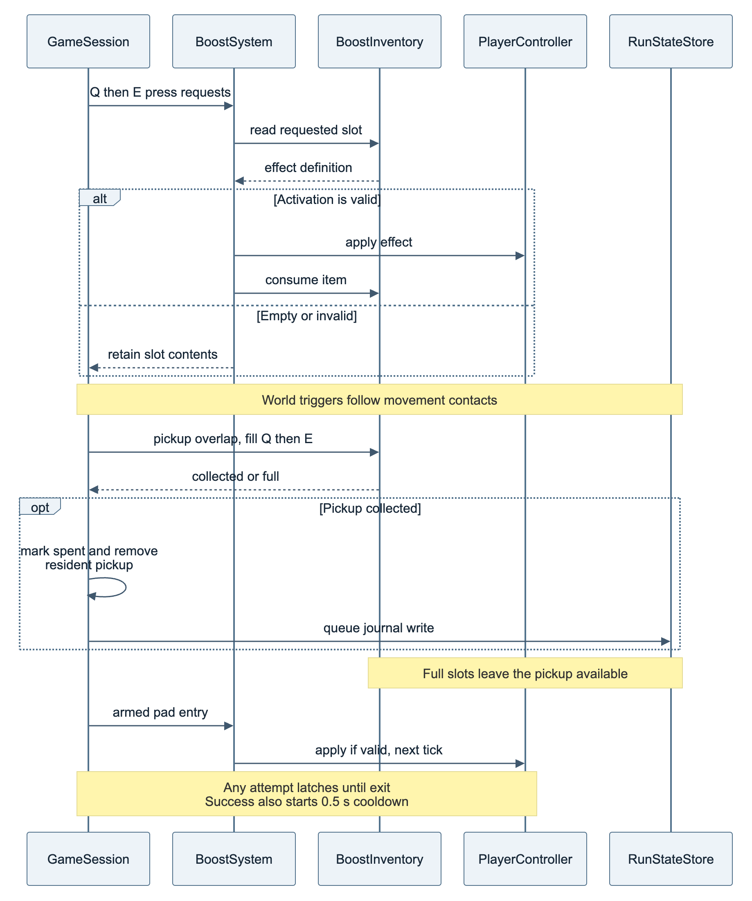

### 08 — Bidirectional streaming

Spent-state loading and worker generation converge before atomic activation. Eviction waits for persistence. [Mermaid source](diagrams/08-sequence-streaming.mmd)

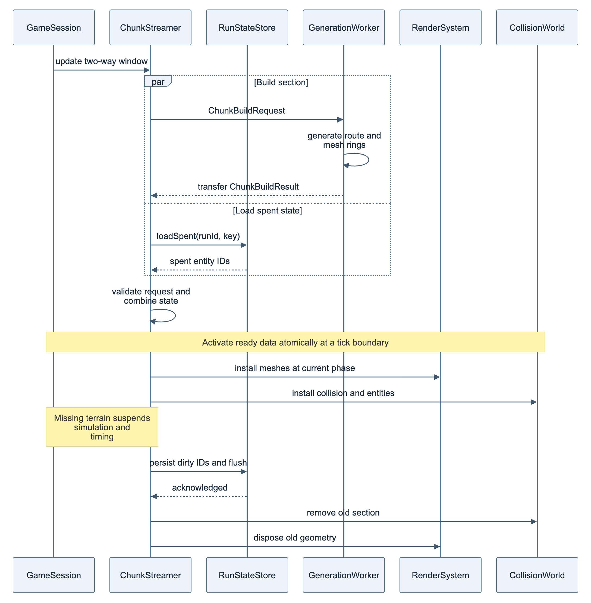

## States and generation

### 09 — Run lifecycle

Suspensions stop gameplay and active timing together. Restart creates a new attempt; it does not resume at a checkpoint. [Mermaid source](diagrams/09-state-run.mmd)

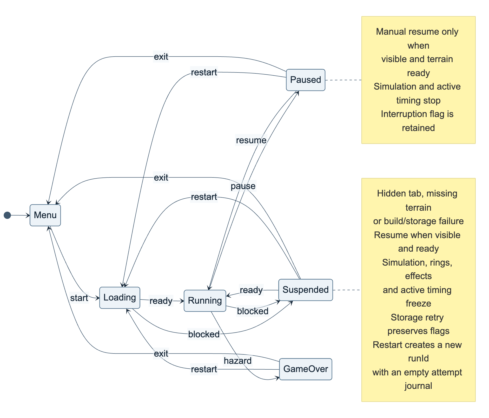

### 10 — Movement state and boost overlay

Grounding, airtime, wall slide, and death are movement modes. Boost effects modify those modes without replacing them. [Mermaid source](diagrams/10-state-movement.mmd)

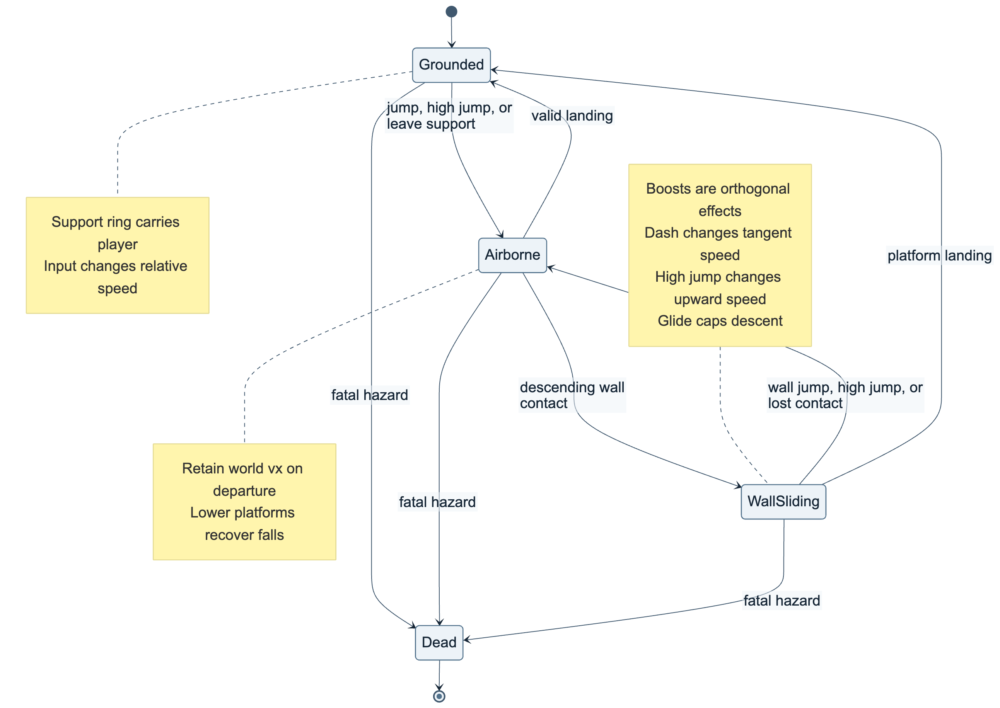

### 11 — Seeded route generation

Canonical boundaries precede candidate validation and voxel decoration. A fixed retry limit leads to a safe deterministic fallback. [Mermaid source](diagrams/11-flow-generation.mmd)

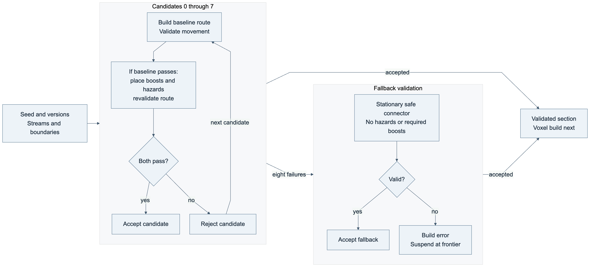

### 14 — Voxel build and activation

After route validation, decoration preserves gameplay clearances. Each rigid ring is meshed separately, and the streamer activates visual and collision data with the spent-item flags. [Mermaid source](diagrams/14-flow-voxel-build.mmd)

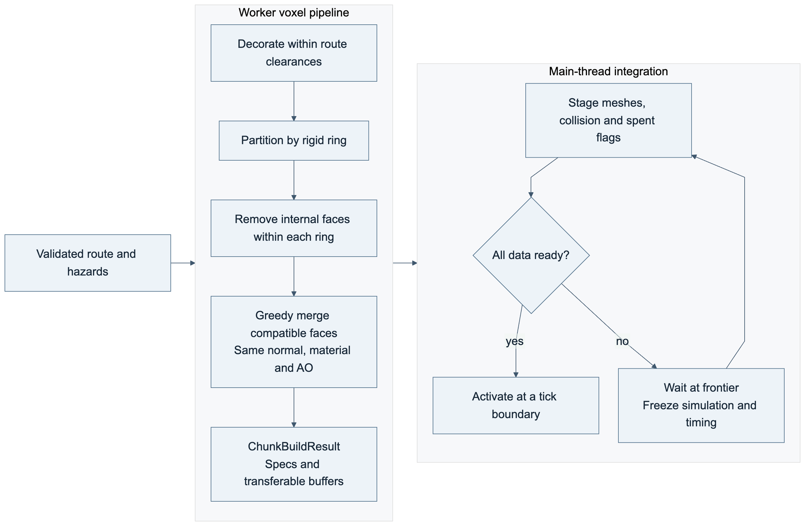
